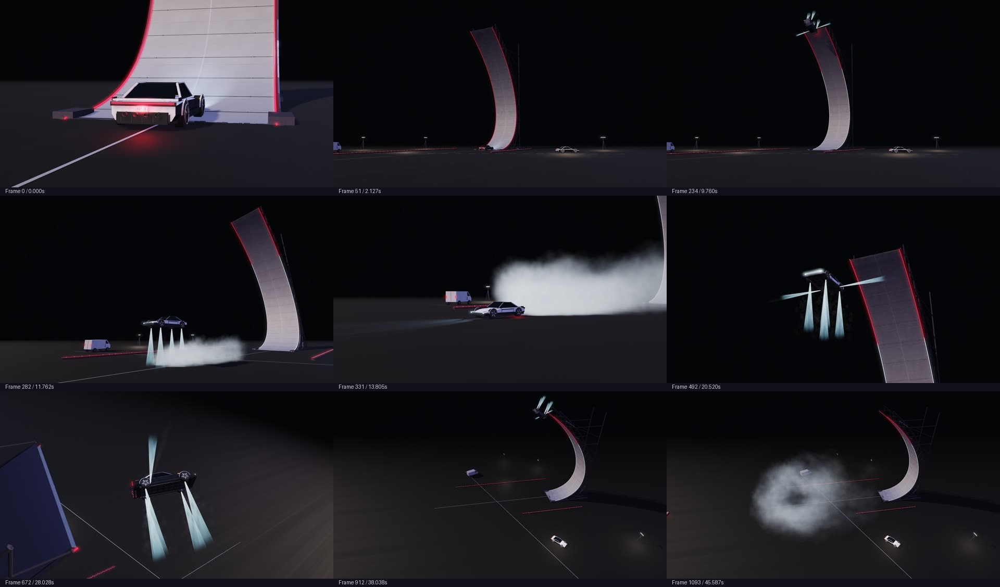

# Roadster — Against Gravity

A local, editable Three.js reconstruction of the supplied Roadster ramp film, using the 404 recipe for procedural geometry and Atlas MCP for generated reference images, concrete maps and visual critique. The treatment follows the user's faceted, ink-edged game screenshots.



**New contributor or AI? Start with [HANDOFF.md](HANDOFF.md).** [Contribution instructions](CONTRIBUTING.md) explain forks and pull requests. The complete source, assets, comparison master and rendered film are included; Git LFS is not required.

## Run

Use **Node 22.12+** (Node 24 recommended).

```sh
git clone https://github.com/AngryDavee/roadster-against-gravity.git
cd roadster-against-gravity
npm ci
npm start
```

Open http://localhost:4174. The static application is entirely inside `app/`; the local server binds to this machine only.

- **Watch the film:** play the five-shot sequence.
- **Timeline / chapters:** seek on the original 23.976 fps frame grid.
- **Compare:** synchronize the local source film beside the 3D rendering. Both retain 16:9 framing.
- **Inspect:** pause, drag to orbit the machine, scroll or pinch to zoom.
- **Save frame:** download a PNG of the actual WebGL render.
- Space plays/pauses; arrows step frames; Shift+arrows step seconds; H hides the interface; Escape restores it.

The comparison source is the user's original video, included at `app/reference/master.mp4`. It is never used as a background or substituted for the rendered scene. The film export is silent; no soundtrack recreation or audio cue audit is claimed.

## Timing and fidelity

The picture master contains **1,094 frames at 24000/1001 fps**, lasting **45.628916667 seconds**. Hard cuts occur at frames **51, 419, 656 and 743**. The source repeats the same stunt from different viewpoints; `app/timeline.js` maps those views back to one shared action timeline.

Cut positions and frame count are exact. Camera calibration, dimensions, vehicle design and vapor motion are visual reconstructions, not a measured or pixel-identical scene solve. Occluded touchdown and hidden mechanical details remain inferred. The supplied video and Roadster stills define the subject; the three game screenshots define the visual treatment.

## Construction

`app/assets/` contains self-contained `function(THREE) → Group` modules: Roadster, ramp, pavement, floodlight bank, boundary strip and service van. No Blender, Unity, Unreal, GLB/OBJ mesh download or encoded mesh payload was used. The car's body, wing and wheels retain articulation through the stock 404 loader; rigid parts are merged with its `bakeStatic` function.

The six families have three construction candidates each in `candidates/`. They were produced in this session using distinct construction strategies, rendered from multiple sides with the canonical verifier and selected visually. They were **not** produced by three independent coding agents. Animation, lighting, vapor, ink treatment and post-processing live outside the geometry modules.

The reference recipe is bundled in `vendor/404-game-recipe`, pinned at `4effad311c5e137bca316257259fe5bffd6737de`. Its `assetlib.js` and `surfaces.js` were copied unchanged. Custom night lighting replaces the optional stock lighting rig. Three.js r169 and its MIT license are vendored locally.

## Atlas provenance

Atlas MCP authenticated with `whoami`. A private production project generated two visual references through Google Nano Banana 2.1 and a concrete material through PATINA. Base-color, roughness and normal maps are applied in the scene. The roughness range is remapped at rendering time to keep the generated concrete matte. No other image-generation service was used.

Receipts and typed output roles are in `references/atlas-output-manifest.json`, `references/atlas-generation-complete.json` and `references/atlas-outputs/`. A separate private Atlas review inspected an anonymous before/after sheet; its critique and the local identity key are retained in `evidence/blind-review/`. It preferred the revised staging and vapor, while identifying remaining issues with close-up silhouette, ink treatment and small action. Subsequent changes addressed wheel fit, contour treatment, nozzle construction and descent framing.

Credentials are read only from `ATLAS_API_KEY` or the current user's launch environment. No key is stored in source, configuration, receipts or the browser. Generated assets are local at runtime; the application does not call Atlas.

## Verification and export

```sh
npm test
npm run recipe:check
npm start # keep running in a separate terminal before capture
npm run capture
node tools/capture.mjs --film --width=1920 --height=1080 --output=evidence/export
```

`npm test` starts an isolated server and exercises desktop mouse input, phone touch, all source cut boundaries, all 1,094 poses, comparison synchronization, orbit controls, repeatable seeking, end/restart behavior and missing resources. Reports and screenshots live in `evidence/checks/`.

`npm run recipe:check` invokes the canonical ship checker. The asset verifier reports **four of six selected modules clean**. Pavement's edge-on views and the ramp's broad front/back surfaces trigger generic empty/featureless-face heuristics; those warnings are retained, not suppressed or presented as a clean gate. Their actual geometry and scene views were inspected. See `references/verification-notes.json` and `app/assets/_verify/`.

The original racing playtest and live game-jam entry gate are not substitutes for testing this cinematic. No live hosting, competition submission or all-green jam verdict is claimed.

The export script requires FFmpeg. Install `ffmpeg` on PATH, or set `FFMPEG` to its executable. No machine-specific path is required. Output is H.264, 1080p, the source frame rate, 1,094 rendered frames and no UI.

## Files to edit

| File | Purpose |
|---|---|
| `app/timeline.js` | Shot cuts, action mapping, vehicle path and cameras |
| `app/assets/roadster.js` | Car geometry and articulated parts |
| `app/assets/ramp.js` | Parametric ramp and steel support structure |
| `app/main.js` | Scene assembly, materials, lighting and controls |
| `app/effects.js` | Deterministic cold-gas jets and ground vapor |
| `app/post.js` | Bloom, tone mapping, grain and vignette |
| `STYLE_LOCK.md` | Approved visual direction and constraints |

The source study and PDF are in `references/source-analysis/`; the supplied car and style stills are in `references/user/`. See [third-party notices](THIRD_PARTY_NOTICES.md) for attribution. Tidebreak is a separate project.
